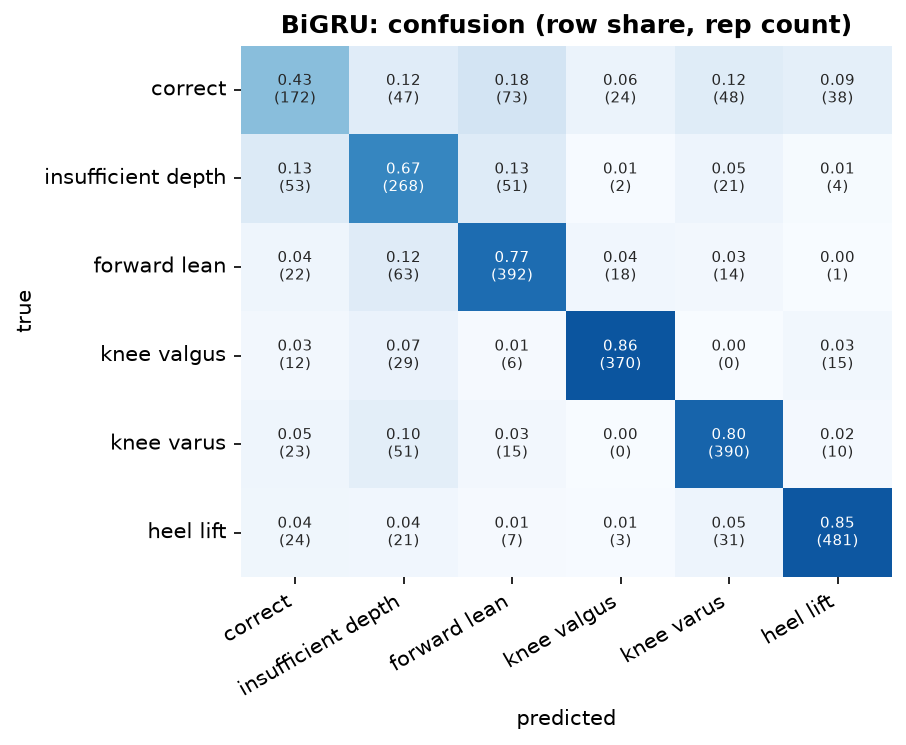
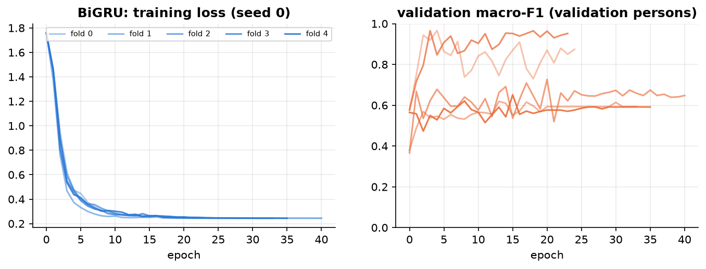
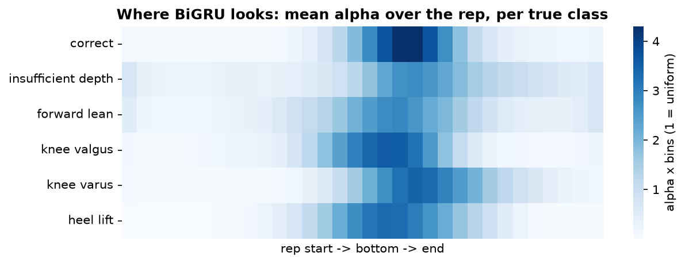

## BiGRU  (recurrent)

**Input.** per frame: 151 channels, 64 frames.

**Processing.** linear projection to 64, 2-layer bidirectional GRU (64 per direction); attention pooling -> alpha; + tempo -> classifier.

**Size.** 168,582 trainable parameters. Training: AdamW (lr 0.001, weight decay 0.01), cosine schedule, up to 60 epochs, early stopping on the validation persons (patience 20), label smoothing 0.05, noise augmentation 0.01.

**Common preprocessing.** 3D joints from Pose2Sim -> body frame (lateral / up / forward from the standing posture and the feet), hip-centred, divided by the leg length; reps trimmed to the movement and resampled to 64 frames; z-scored with training-fold statistics.

**Performance (5-fold cross-validation by person x 3 seeds = 15 runs).**

| metric | value |
|---|---|
| macro-F1 per rep | 0.717 ± 0.100 |
| accuracy per rep | 0.738 ± 0.090 |
| macro-F1 per recording (vote) | 0.754 ± 0.120 |
| best / worst run | 0.878 / 0.493 |
| alpha check: drop when the top-10 % alpha frames are masked vs random | 0.031 vs 0.001 |
| median best epoch | 14 |
| training time (15 runs) | 1.2 min |

**F1 per class.**

| class              |    F1 |   reps |
|:-------------------|------:|-------:|
| correct            | 0.486 |    402 |
| insufficient depth | 0.610 |    399 |
| forward lean       | 0.744 |    510 |
| knee valgus        | 0.872 |    432 |
| knee varus         | 0.785 |    489 |
| heel lift          | 0.862 |    567 |

Weakest class: **correct** (F1 0.49). Most frequent confusion: **correct -> forward lean** (73 reps).

