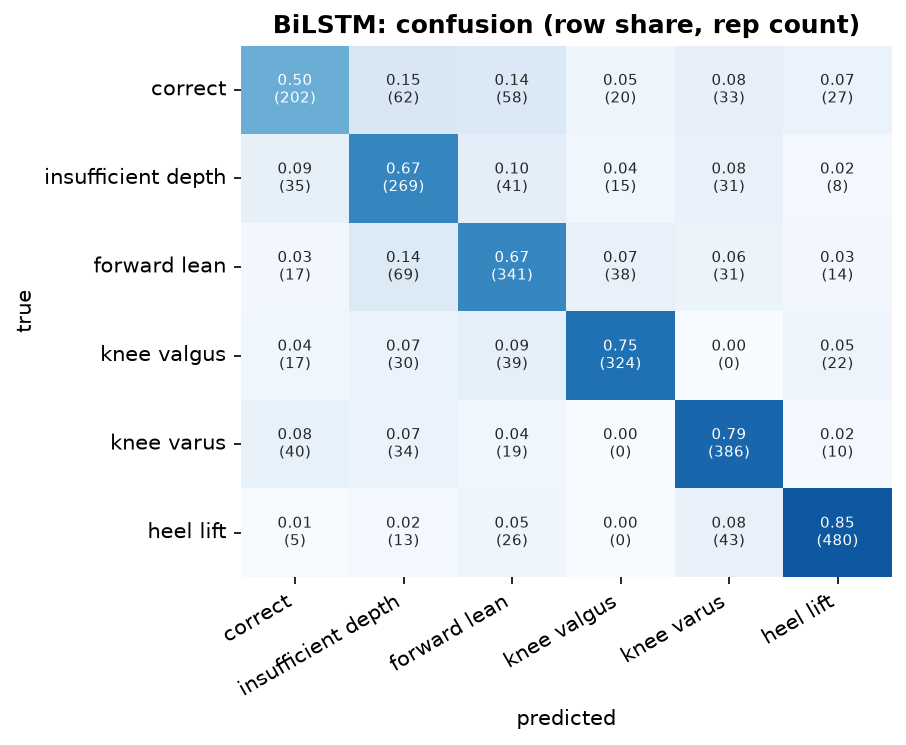
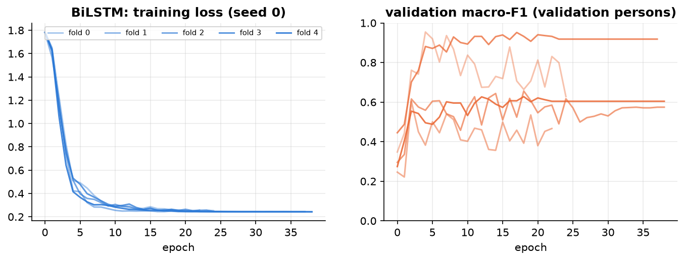
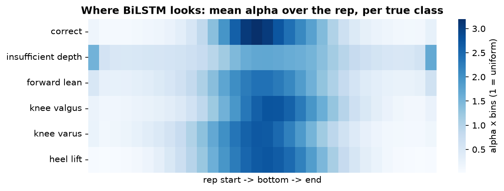

## BiLSTM  (recurrent)

**Input.** per frame: 151 channels (as 1D-CNN), 64 frames.

**Processing.** linear projection to 64, 2-layer bidirectional LSTM (64 per direction): every frame summarises the whole rep in both directions; attention pooling -> alpha; + tempo -> classifier.

**Size.** 210,054 trainable parameters. Training: AdamW (lr 0.001, weight decay 0.01), cosine schedule, up to 60 epochs, early stopping on the validation persons (patience 20), label smoothing 0.05, noise augmentation 0.01.

**Common preprocessing.** 3D joints from Pose2Sim -> body frame (lateral / up / forward from the standing posture and the feet), hip-centred, divided by the leg length; reps trimmed to the movement and resampled to 64 frames; z-scored with training-fold statistics.

**Performance (5-fold cross-validation by person x 3 seeds = 15 runs).**

| metric | value |
|---|---|
| macro-F1 per rep | 0.693 ± 0.078 |
| accuracy per rep | 0.713 ± 0.077 |
| macro-F1 per recording (vote) | 0.737 ± 0.076 |
| best / worst run | 0.807 / 0.518 |
| alpha check: drop when the top-10 % alpha frames are masked vs random | 0.007 vs -0.001 |
| median best epoch | 15 |
| training time (15 runs) | 1.3 min |

**F1 per class.**

| class              |    F1 |   reps |
|:-------------------|------:|-------:|
| correct            | 0.563 |    402 |
| insufficient depth | 0.614 |    399 |
| forward lean       | 0.660 |    510 |
| knee valgus        | 0.782 |    432 |
| knee varus         | 0.762 |    489 |
| heel lift          | 0.851 |    567 |

Weakest class: **correct** (F1 0.56). Most frequent confusion: **forward lean -> insufficient depth** (69 reps).

