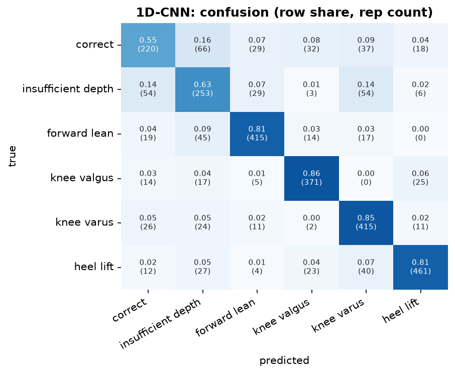
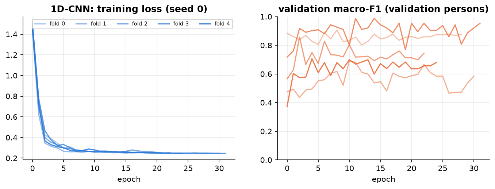
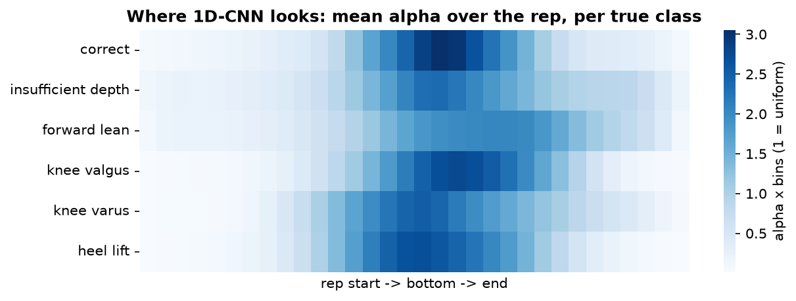

## 1D-CNN  (convolutional)

**Input.** per frame: 22 joints x 6 (position + velocity, body frame) + 19 frame features = 151 channels, 64 frames.

**Processing.** 3 Conv1d layers (kernel 5; 64 -> 128 -> 128 channels; BatchNorm, GELU, dropout): each output sees 13 frames; attention pooling over the 64 frames -> alpha; + 4 tempo numbers -> classifier.

**Size.** 206,598 trainable parameters. Training: AdamW (lr 0.001, weight decay 0.01), cosine schedule, up to 60 epochs, early stopping on the validation persons (patience 20), label smoothing 0.05, noise augmentation 0.01.

**Common preprocessing.** 3D joints from Pose2Sim -> body frame (lateral / up / forward from the standing posture and the feet), hip-centred, divided by the leg length; reps trimmed to the movement and resampled to 64 frames; z-scored with training-fold statistics.

**Performance (5-fold cross-validation by person x 3 seeds = 15 runs).**

| metric | value |
|---|---|
| macro-F1 per rep | 0.747 ± 0.089 |
| accuracy per rep | 0.762 ± 0.091 |
| macro-F1 per recording (vote) | 0.763 ± 0.112 |
| best / worst run | 0.874 / 0.540 |
| alpha check: drop when the top-10 % alpha frames are masked vs random | 0.054 vs 0.006 |
| median best epoch | 10 |
| training time (15 runs) | 1.1 min |

**F1 per class.**

| class              |    F1 |   reps |
|:-------------------|------:|-------:|
| correct            | 0.589 |    402 |
| insufficient depth | 0.609 |    399 |
| forward lean       | 0.828 |    510 |
| knee valgus        | 0.846 |    432 |
| knee varus         | 0.789 |    489 |
| heel lift          | 0.847 |    567 |

Weakest class: **correct** (F1 0.59). Most frequent confusion: **correct -> insufficient depth** (66 reps).

