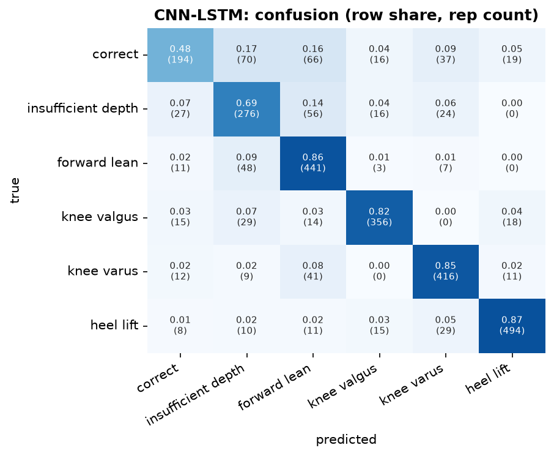
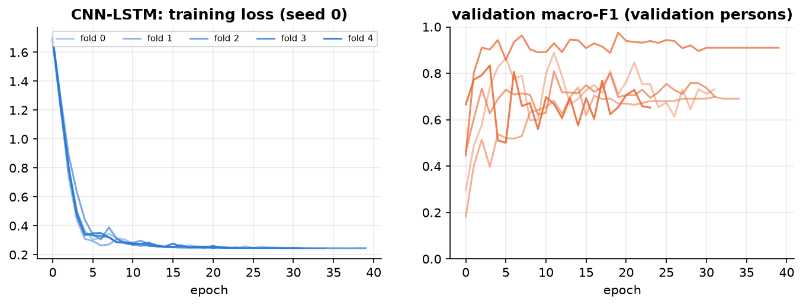
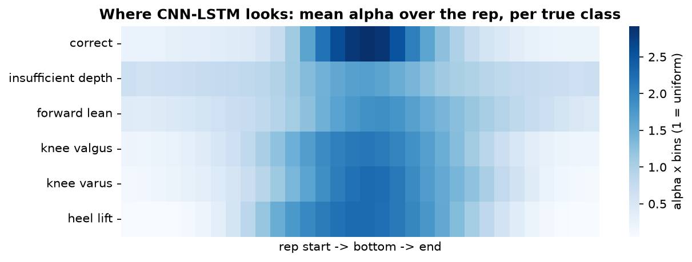

## CNN-LSTM  (hybrid)

**Input.** per frame: 151 channels, 64 frames.

**Processing.** 3 Conv1d blocks (kernel 5, 64 channels, LayerNorm, residual) extract local movement, then a 2-layer bidirectional LSTM (32 per direction) relates them over the rep; attention pooling (32) -> alpha; tempo through a small MLP -> classifier.

**Size.** 155,398 trainable parameters. Training: AdamW (lr 0.001, weight decay 0.01), cosine schedule, up to 60 epochs, early stopping on the validation persons (patience 20), label smoothing 0.05, noise augmentation 0.01.

**Common preprocessing.** 3D joints from Pose2Sim -> body frame (lateral / up / forward from the standing posture and the feet), hip-centred, divided by the leg length; reps trimmed to the movement and resampled to 64 frames; z-scored with training-fold statistics.

**Performance (5-fold cross-validation by person x 3 seeds = 15 runs).**

| metric | value |
|---|---|
| macro-F1 per rep | 0.758 ± 0.108 |
| accuracy per rep | 0.775 ± 0.102 |
| macro-F1 per recording (vote) | 0.777 ± 0.123 |
| best / worst run | 0.911 / 0.533 |
| alpha check: drop when the top-10 % alpha frames are masked vs random | 0.023 vs 0.004 |
| median best epoch | 13 |
| training time (15 runs) | 1.5 min |

**F1 per class.**

| class              |    F1 |   reps |
|:-------------------|------:|-------:|
| correct            | 0.580 |    402 |
| insufficient depth | 0.656 |    399 |
| forward lean       | 0.774 |    510 |
| knee valgus        | 0.850 |    432 |
| knee varus         | 0.830 |    489 |
| heel lift          | 0.891 |    567 |

Weakest class: **correct** (F1 0.58). Most frequent confusion: **correct -> insufficient depth** (70 reps).

