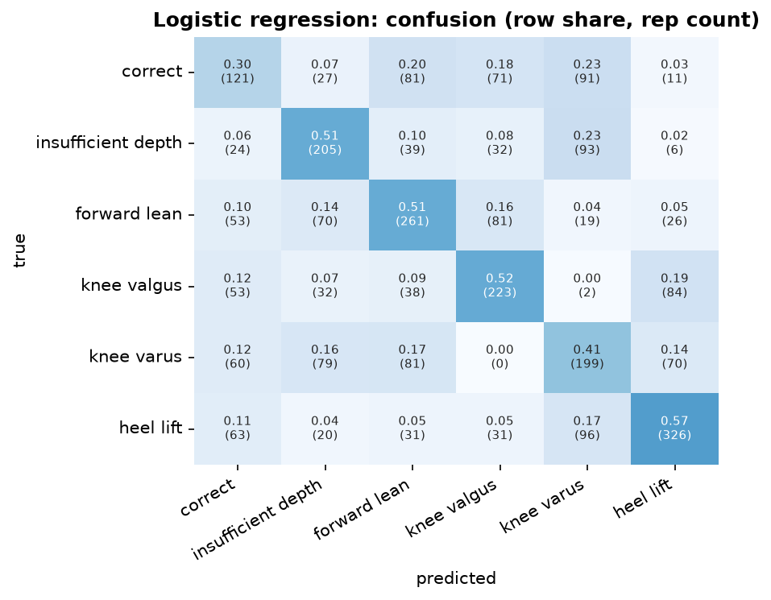

## Logistic regression  (classical baseline)

**Input.** summary row: 46 statistics per rep from rep_features.csv (min / max / at-bottom of each pipeline angle) + 4 tempo numbers = 50 values.

**Processing.** median imputation of missing values, z-score, multinomial logistic regression (L2, C = 1); sample weights: every recording counts equally.

**Preprocessing.** The summary row is computed by the Pose2Sim preprocessing pipeline per rep (`rep_features.csv`, statistics of its joint angles); the 4 tempo numbers come from the trimmed rep. No body-frame joints are used.

**Performance (5-fold cross-validation by person x 3 seeds = 15 runs).**

| metric | value |
|---|---|
| macro-F1 per rep | 0.460 ± 0.078 |
| accuracy per rep | 0.478 ± 0.076 |
| macro-F1 per recording (vote) | 0.470 ± 0.130 |
| best / worst run | 0.580 / 0.279 |
| training time (15 runs) | 0.0 min |

**F1 per class.**

| class              |    F1 |   reps |
|:-------------------|------:|-------:|
| correct            | 0.312 |    402 |
| insufficient depth | 0.493 |    399 |
| forward lean       | 0.501 |    510 |
| knee valgus        | 0.513 |    432 |
| knee varus         | 0.402 |    489 |
| heel lift          | 0.598 |    567 |

Weakest class: **correct** (F1 0.31). Most frequent confusion: **heel lift -> knee varus** (96 reps).

