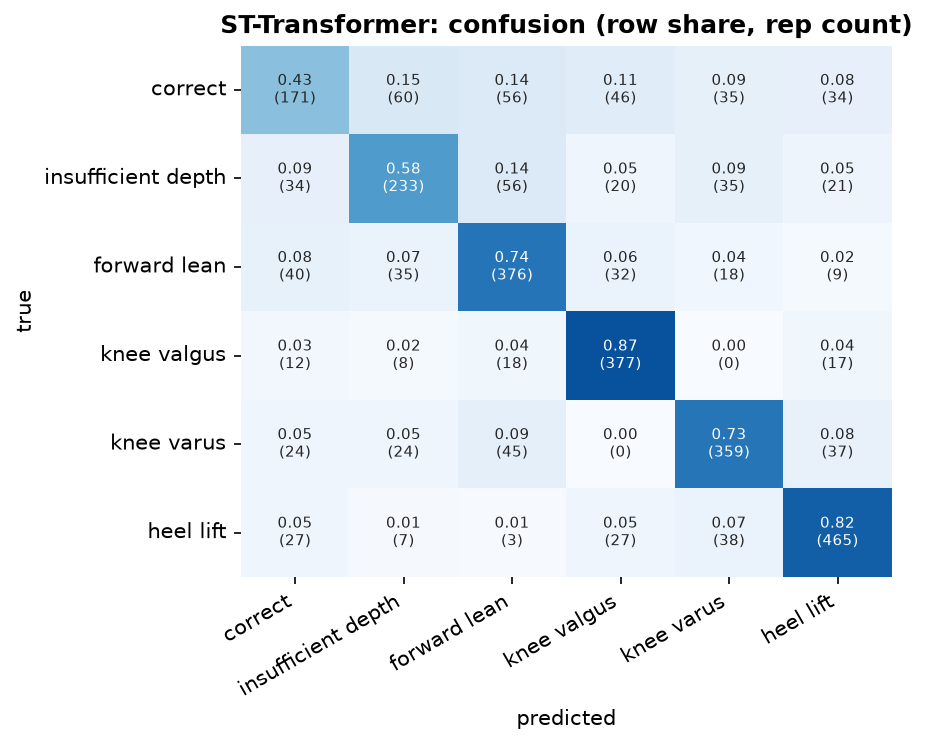
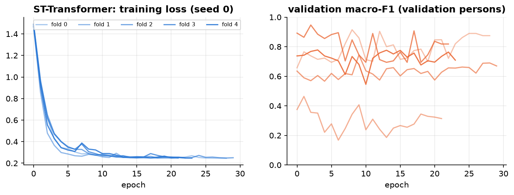
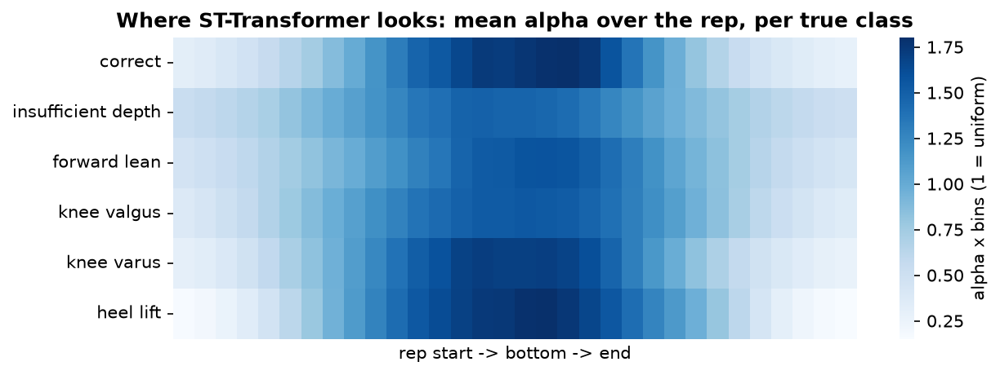

## ST-Transformer  (attention)

**Input.** per frame: 22 joint tokens (6 values each) + 1 frame token (19 features) = 23 tokens, 64 frames.

**Processing.** tokens embedded to 64 + learned joint and time tags; 4 blocks of [spatial self-attention over the 23 tokens of a frame -> temporal self-attention over the 64 frames of each token -> MLP 64-256-64]; the 64 frame tokens -> attention pooling (32) -> alpha; tempo MLP -> classifier.

**Size.** 289,670 trainable parameters. Training: AdamW (lr 0.001, weight decay 0.01), cosine schedule, up to 60 epochs, early stopping on the validation persons (patience 20), label smoothing 0.05, noise augmentation 0.01.

**Common preprocessing.** 3D joints from Pose2Sim -> body frame (lateral / up / forward from the standing posture and the feet), hip-centred, divided by the leg length; reps trimmed to the movement and resampled to 64 frames; z-scored with training-fold statistics.

**Performance (5-fold cross-validation by person x 3 seeds = 15 runs).**

| metric | value |
|---|---|
| macro-F1 per rep | 0.677 ± 0.093 |
| accuracy per rep | 0.706 ± 0.086 |
| macro-F1 per recording (vote) | 0.689 ± 0.121 |
| best / worst run | 0.861 / 0.511 |
| alpha check: drop when the top-10 % alpha frames are masked vs random | 0.011 vs 0.003 |
| median best epoch | 6 |
| training time (15 runs) | 56.4 min |

**F1 per class.**

| class              |    F1 |   reps |
|:-------------------|------:|-------:|
| correct            | 0.482 |    402 |
| insufficient depth | 0.608 |    399 |
| forward lean       | 0.707 |    510 |
| knee valgus        | 0.807 |    432 |
| knee varus         | 0.737 |    489 |
| heel lift          | 0.809 |    567 |

Weakest class: **correct** (F1 0.48). Most frequent confusion: **correct -> insufficient depth** (60 reps).

