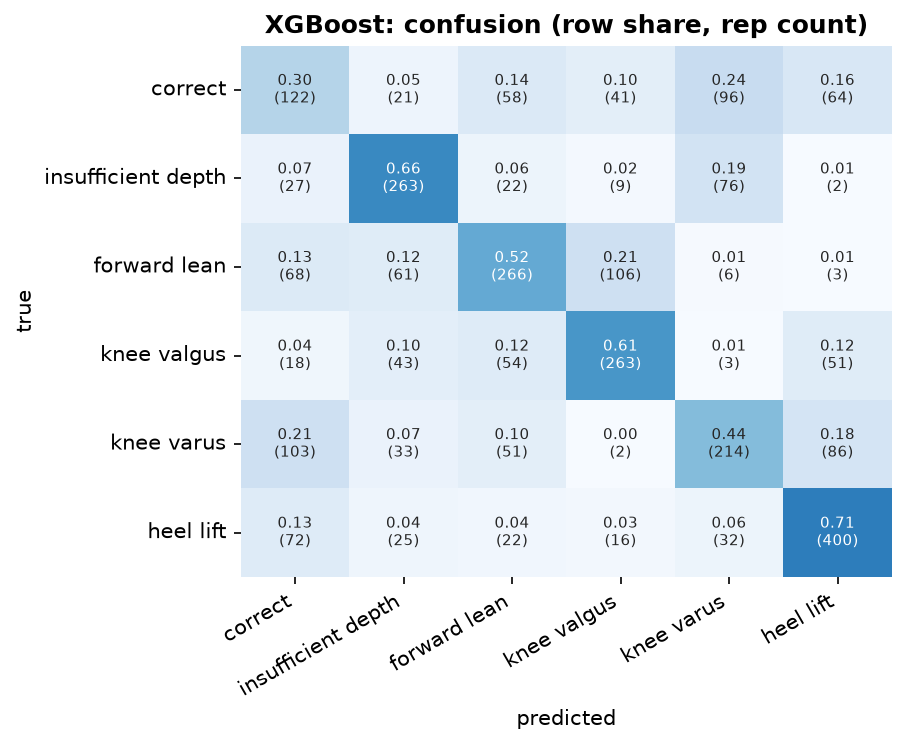

## XGBoost  (classical baseline)

**Input.** summary row (46) + tempo (4) = 50 values per rep.

**Processing.** median imputation, 300 gradient-boosted trees, depth 4, learning rate 0.1, row / column subsampling 0.9.

**Preprocessing.** The summary row is computed by the Pose2Sim preprocessing pipeline per rep (`rep_features.csv`, statistics of its joint angles); the 4 tempo numbers come from the trimmed rep. No body-frame joints are used.

**Performance (5-fold cross-validation by person x 3 seeds = 15 runs).**

| metric | value |
|---|---|
| macro-F1 per rep | 0.527 ± 0.053 |
| accuracy per rep | 0.546 ± 0.043 |
| macro-F1 per recording (vote) | 0.564 ± 0.088 |
| best / worst run | 0.604 / 0.399 |
| training time (15 runs) | 0.4 min |

**F1 per class.**

| class              |    F1 |   reps |
|:-------------------|------:|-------:|
| correct            | 0.300 |    402 |
| insufficient depth | 0.622 |    399 |
| forward lean       | 0.541 |    510 |
| knee valgus        | 0.605 |    432 |
| knee varus         | 0.467 |    489 |
| heel lift          | 0.682 |    567 |

Weakest class: **correct** (F1 0.30). Most frequent confusion: **forward lean -> knee valgus** (106 reps).

